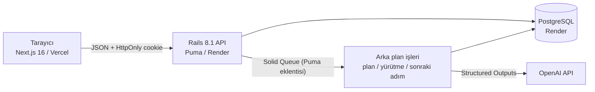

# JokerAI

**Görevleri listeleme. Yürüt.** Hedefini tek cümleyle yaz: JokerAI projeyi kurar, işi ekibe dağıtır, analiz, taslak, içerik ve entegrasyon işlerini kendisi yürütür. Sen yalnızca kontrol eder ve onaylarsın.

| | |
|---|---|
| Canlı uygulama | https://jokerai.abdulsametok.com |
| Canlı API | https://api-jokerai.abdulsametok.com/api/health |
| Repo | https://github.com/Abdulsametok/jokerai-jai |
| Demo girişi | Giriş ekranındaki demo kullanıcı düğmeleri (parola: `jokerai2026`) |

Demo kullanıcıları: **Deniz Arslan** (operasyon müdürü, projelerde yönetici ve ajan çıktılarını onaylayan kişi), **Mert Kaya** (veri analisti), **Ece Yıldız** (vardiya planlama uzmanı). Tüm veri sentetiktir; hayali bir lojistik şirketi olan "Northwind Lojistik" için üretilmiştir.

## Firma, SaaS ve kanıt

| | |
|---|---|
| Fortune 500 firması | FedEx |
| Kullandığı SaaS | Asana (iş ve proje yönetimi) |
| Kanıt | https://asana.com/case-study/fedex |

**Klonlanan ana değer akışı:** ekipler arası işi tek bir yerde planlamak, sahiplik ve son tarihlerle takip etmek, ilerlemeyi görünür kılmak ve iş birliğini görev bağlamında yürütmek. JokerAI bu akışın işlevini kendi markası, kendi arayüzü ve kendi koduyla yeniden kurar. Rakip ürünün adı, logosu, renkleri ve giriş ekranı kullanılmaz, hiçbir içerik scrape edilmez.

## Uçtan uca çalışan iş akışları

### 1. Proje ve görev yönetimi (liste görünümü)
Proje oluştur, bölümlere (Yapılacak, Devam ediyor, İncelemede, Tamamlandı) görev ekle. Görevlere sorumlu, son tarih, öncelik, alt görev ve bağımlılık ver; satır içinden tamamla veya çekmecede düzenle. Proje ilerlemesi otomatik hesaplanır.

### 2. Kanban pano
Aynı proje pano görünümünde açılır. Kartları sürükleyip bırakarak bölüm ve sıra değiştirilir; sıra sunucuda kalıcıdır. "Tamamlandı" sütununa taşımak görevi tamamlar, oradan çıkarmak yeniden açar.

### 3. İş birliği: yorum, @bahsetme, Görevlerim ve gelen kutusu
Görev çekmecesinde yorum yazılır; `@` ile ekip arkadaşı seçilir ve bahsedilen kişiye bildirim gider. Her değişiklik aktivite akışına düşer. **Görevlerim** ekranı kişiye atanan işleri Gecikmiş, Bugün, Bu hafta, Daha sonra şeklinde gruplar. Gelen kutusu atama, bahsetme, yorum, tamamlama ve onay isteklerini toplar.

## AI-native katman: execution-first

Klasik iş yönetimi araçları işi listeler, yürütmeyi insana bırakır. JokerAI'da ajan işin kendisini yapar, insan onaylar (human-in-the-loop):

1. **Hedef → plan.** Kullanıcı bir hedef yazar ("Yılbaşı yoğunluğu için Ankara aktarma merkezinde gece vardiyası kapasitesini %30 artır"). Ajan hedefi 5-8 teslim edilebilir göreve böler, bağımlılık sırasını kurar, ekip üyelerinin yeteneklerine ve açık iş yüküne göre sorumlu önerir, kendi yürütebileceği görevleri (analiz, taslak, içerik, entegrasyon, kontrol listesi) işaretler ve riskleri listeler.
2. **İnsan planı düzenler.** Plan önizlemesinde görev çıkarılır, sorumlu değiştirilir ya da ek bağlamla yeniden planlatılır. "Onayla" ile proje, görevler, alt görevler ve bağımlılıklar oluşturulur.
3. **Ajan hemen yürütür.** Bağımlılığı karşılanmış ajan görevleri arka planda (Solid Queue) çalışır. Ajan bitmiş bir iş teslim eder (analiz raporu, uygulama planı, paydaş duyurusu, entegrasyon spesifikasyonu, kontrol listesi), görevi "İncelemede"ye taşır ve proje yöneticilerine onay isteği gönderir.
4. **Onay veya geri bildirimle ret.** Yönetici çıktıyı okur. Onaylarsa görev tamamlanır. Reddederse yazdığı geri bildirimle ajan yeni bir sürüm üretir; sürüm geçmişi saklanır.
5. **Sonraki adım pası.** Bir görev tamamlandığında ona bağlı sonraki adım hazır hale gelir. Sonraki görev ajan göreviyse ajan onu kendiliğinden başlatır ve önceki onaylı çıktıları bağlam olarak kullanır. İnsan göreviyse ajan sorumluya başlangıç brifi yazar ve bildirim gönderir.
6. **Maliyet paneli.** Her LLM çağrısı token, maliyet ve süre ile sunucuda `agent_runs` tablosuna yazılır. Arayüzdeki "AI maliyeti" ekranı yalnızca maliyeti gösterir: toplam maliyet, onaylanan çıktı başına maliyet, iş türüne göre maliyet ve son işlemler. Model adı ve token ayrıntısı arayüze çıkmaz.

**İş akışını nasıl değiştiriyor:** Görevlerim ekranında en üstte "JokerAI işi bitirdi, sadece onayın gerekiyor" bölümü yer alır. Yöneticinin işi görev yazmak ve takip etmek yerine hazır çıktıyı kontrol etmeye dönüşür.

### AI teknik ayrıntıları
- LLM çağrıları ve API anahtarı yalnızca Rails'tedir (`OPENAI_API_KEY` Render ortam değişkeni). Tarayıcıya anahtar gitmez; frontend yalnızca JokerAI API'sini çağırır.
- OpenAI Chat Completions ve **Structured Outputs** (`json_schema`, `strict`) kullanılır. Plan, görev çıktısı ve brif çıktıları şemaya uyar; geçersiz kullanıcı kimlikleri ve ileri yönlü bağımlılıklar sunucuda temizlenir.
- Varsayılan model `gpt-4o-mini`'dir (`OPENAI_MODEL` ile değiştirilebilir).
- Geliştirme ve testte anahtar yoksa deterministik bir çevrimdışı istemci kullanılır. Production'da anahtar yoksa çağrı hata verir; sahte çıktı üretilmez.
- LLM kesintisinde ajan görevi "başarısız" durumuna geçer ve tekrar çalıştırılabilir. Sonraki adımın sorumlusu brif üretilemese de bilgilendirilir.

### Demo akışı (yaklaşık 4 dakika)
1. Deniz olarak gir. Görevlerim ekranında gecikmiş ve bugünkü işler görünür. Bir projeyi aç, liste ve pano arasında geç, bir kartı "Devam ediyor" sütununa sürükle.
2. Bir görevde yorum yaz, `@` yazıp listeden Mert Kaya'yı seç. Mert'e geçince gelen kutusunda bildirim görünür.
3. Deniz'e dön, "Hedef ver, ajan yürütsün" ekranında örnek bir hedef seç ve "Planı çıkar"a bas. Plan önizlemesinde bir görevin sorumlusunu değiştir ve onayla.
4. Projede ilk ajan görevi "İncelemede"ye gelir. Çıktıyı geri bildirimle reddet; v2 gelir. Onayla; görev tamamlanır ve sıradaki ajan görevi kendiliğinden başlar.
5. "AI maliyeti" ekranında toplam maliyeti ve onaylanan çıktı başına maliyeti göster.

## Mimari



- **Frontend:** Next.js 16 (App Router, Cache Components), Tailwind 4, SWR, dnd-kit, react-markdown.
- **Backend:** Rails 8.1 `--api`, PostgreSQL. Solid Queue tek veritabanında çalışır ve ücretsiz katmanda ayrı worker gerektirmemesi için Puma içinde eklenti olarak başlar (`SOLID_QUEUE_IN_PUMA=1`). Canlıda `/api/health` worker, dispatcher ve scheduler süreçlerini raporlar.

## Güvenlik

- Parolalar bcrypt (`has_secure_password`) ile hash'lenir.
- Oturum belirteci tarayıcıda JavaScript'in erişebileceği bir yerde saklanmaz. `HttpOnly; Secure; SameSite=Lax` cookie kullanılır, veritabanında yalnızca SHA-256 özeti tutulur ve oturum 7 gün geçerlidir.
- Yetkilendirme her istekte üyelik üzerinden yapılır. Üyesi olunmayan proje ve görevler 404 döner. Ajan çıktısını onaylama/reddetme ve üye yönetimi yalnızca proje sahibi ve yöneticilere açıktır (403). Hedefler sahibine özeldir.
- CSRF'e karşı, GET dışındaki isteklerde `Origin` başlığı izin listesiyle karşılaştırılır. CORS yalnızca frontend alan adına açıktır.
- Giriş ve kayıt uç noktalarında hız sınırı vardır. Demo reset uç noktası `X-Admin-Token` ile korunur.

## Yerel kurulum

Gereksinimler: Ruby 3.3, Node 20.9+, Docker (PostgreSQL için).

```bash
docker run -d --name jokerai-pg -p 5433:5432 -e POSTGRES_USER=jokerai -e POSTGRES_PASSWORD=jokerai -v jokerai-pg-data:/var/lib/postgresql/data postgres:17-alpine

cd api
bundle install
bin/rails db:prepare        # şema + sentetik demo verisi
bin/rails server -p 3001    # OPENAI_API_KEY yoksa çevrimdışı ajan istemcisi kullanılır

cd ../web
npm install
npm run dev                 # http://localhost:3000  (NEXT_PUBLIC_API_URL varsayılanı http://localhost:3001)
```

Demo verisini sıfırlamak için `bin/rails demo:reset` kullanılır.

## Testler

```bash
cd api && bin/rails test    # 24 entegrasyon testi
cd web && npx eslint . && npx tsc --noEmit && npm run build
```

Testler kimlik doğrulama, cookie bayrakları, origin kontrolü, üyelik bazlı yetki (404/403), idempotent seed ve ajan akışının tamamını kapsar: hedef → plan → kabul → otomatik yürütme → onay → sonraki adım, geri bildirimle ret → yeni sürüm ve LLM kesintisi.

## Deploy ve veri kurtarma

Render (API + Postgres, `render.yaml` Blueprint), Vercel (frontend), Cloudflare DNS. Adımlar, canlı doğrulama komutları, demo reset, `pg_dump`/`pg_restore` ve doğrulanmış kurtarma tablosu [docs/DEPLOY.md](docs/DEPLOY.md) dosyasındadır.

## Metrikler

Ayrıntılı oturum kaydı: [docs/METRICS.md](docs/METRICS.md).

| Metrik | Değer |
|--------|-------|
| Token maliyeti, coding agent ($) | Cursor kullanım panelinden: _doldurulacak_ |
| Token maliyeti, ürün içi OpenAI ($) | Canlı "AI maliyeti" ekranından: _demo sonrası doldurulacak_ |
| Toplam çalışma süresi (saat) | 2.9 (oturum 1: 1.25, oturum 2: 1.65; 02:37-05:30) |
| Satır sayısı (LOC, boş satırsız) | 5.554 (API uygulama 1.709, API config 375, migration+seed 314, API test 287, web 2.869) |
| Modeller | Geliştirme: Cursor Auto. Ürün içi: OpenAI gpt-4o-mini |
| Coding agent | Cursor Agent |
| Agent oturum sayısı | 2 |

## Bilinen sınırlamalar

- Render ücretsiz katmanında servis 15 dakika boşta kalınca uyur; ilk istek yaklaşık 30-60 saniye sürebilir. Sunumdan önce bir uptime pinger ile `/api/health` çağrılır.
- Render ücretsiz PostgreSQL 30 gün sonra silinir. Yeniden kurulum ve yedekten geri yükleme adımları [docs/DEPLOY.md](docs/DEPLOY.md) dosyasındadır.
- Oturum cookie'si API alan adına yazılır. Bu yüzden giriş yalnızca özel alan adlarında çalışır, `*.vercel.app` önizleme adreslerinde çalışmaz.
